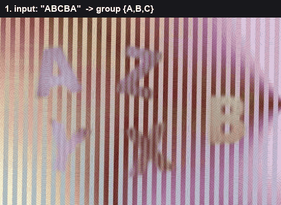
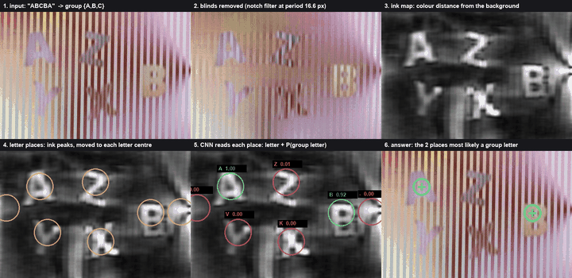
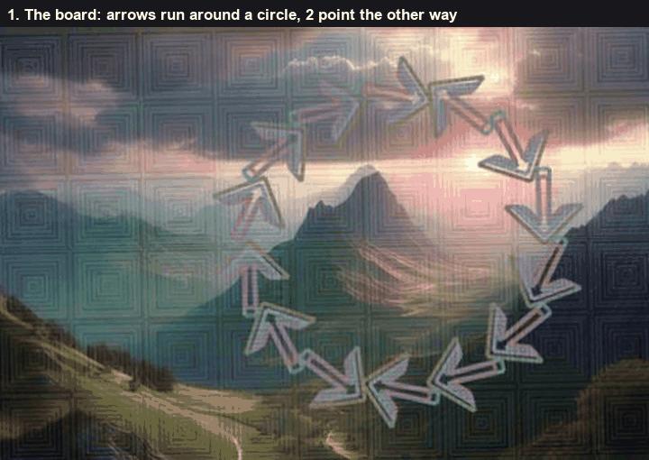
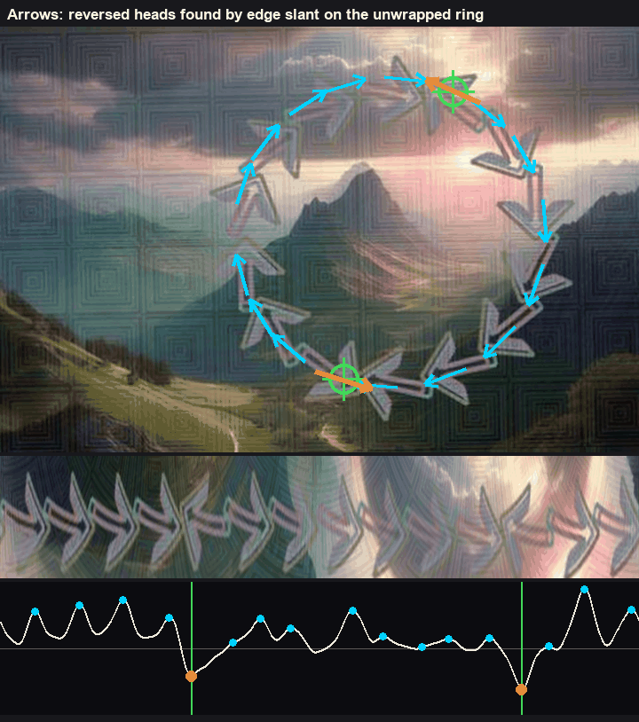
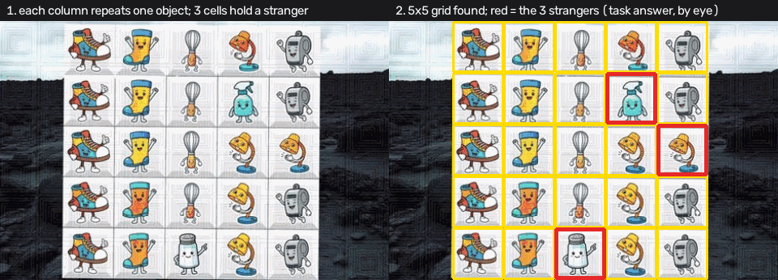

# Area select

Click a spot on a still picture. The picture is 480 by 320. The same questions also show up as short clips, and those are in the video note.

Which reading I use depends on the words.

Letters, when the question names a group. Arrows, when they stand out from a circle. A broken pattern. Rings you can lift off a larger circle. Something turning against the group. A flower the bee never lands on. If none of those fit, I treat it as odd one out.

## Letters

Click the letters that belong to the group. The question looks like "the two letters that are part of this group: ABCBA".

The letters sit behind a ribbed glass. The ribs are about 16 pixels apart, a little slanted, and they lighten and darken the picture in stripes. I find that stripe as one sharp line in the frequency of the picture, and I notch it out, along with its repeats. What's left, I turn into ink: how far each pixel's colour is from a background that ignores the letters. The background is a wide median, so a letter doesn't pull it. A last horizontal smear, one rib wide, cleans what's left of the stripe.

The strongest ink peaks, away from the border, are the letter places. I slide each peak onto the middle of its letter. A small net reads a crop of the ink. It knows A to Z and "this isn't a letter". It was trained only on boards I generated: pastel ground, swirls, a few heavy letters, the same ribbed glass, and JPEG on the way out. About thirty thousand crops. No real board in the training. The score of a place is the summed probability of the letters named in the group. I click the top two, or three, or four, depending on the question. If every click is at least half sure, I'm confident.

*The steps on one board. The last frame is the click, in green.*

On that board the rib spacing comes out at 16.6 pixels, and the group is ABC. The places read as K, Z, A, B, V, and two spots that are the border or a swirl and get read as no letter. A and B are the sure ones, near (101, 90) and (380, 156). The clicks on this board were (111, 110) and (393, 171). The V crop is actually a Y. The net's top guess there is just wrong, and its probability on the group letters is about zero, so it doesn't get clicked.

## Arrows

Pick the arrows that stand out from the circle.

About fifteen faint arrows run around a circle, all pointing the same way except two. A reversed arrow's head faces its neighbour's head. Like `> > > < > >`.

I fit a circle through the pixels that have the arrow colour, then I nudge the centre until the band around the circle is mirror-symmetric. An arrow is symmetric about its own axis, so a good centre makes the band fold onto itself. I cut the ring open into a straight strip. Now the normal arrows point one way and the reversed ones point the other.

The direction is in the head, not the shaft. A head pointing right has its outer wing going one diagonal and its inner wing going the other. I multiply the horizontal edge by the vertical edge. That product is negative on one diagonal and positive on the other. Sum the outer part of the strip minus the inner part, and a normal head becomes a bump and a reversed head becomes a dip. Shafts are flat and add nothing.

Whichever sign most of the heads share is the flow. I click the strongest heads of the other sign.

I tried, earlier, cutting the ring into slices and taking the long axis of each slice as the arrow. That axis mostly points out from the centre of the circle, so "with the flow" or "against it" was noise. The wings are what carry the direction.

*Cyan heads go with the flow. Orange heads go against it. Green is the click. Under the picture, the unwrapped ring. Bumps are the normal heads, dips are the reversed ones.*

On that board the circle settles near (293, 155) with radius 116. Unwrapped, that's about 729 pixels around, and the arrows are about 51 pixels apart. Fifteen heads point clockwise. The two the other way are much stronger than the next dip, several times stronger, and they're in the same range as a normal head, so I'm confident. The clicks are near (340, 49) and (258, 265). The clicks on this board were (342, 62) and (251, 265).

How many arrows I expect is loose. I look for a spacing that would mean somewhere between 9 and 22 of them. A head has to be separated from the next head of the same sign by at least a bit more than half a spacing, or I'm counting the same head twice.

## A broken pattern

Select the items that break the pattern. Usually three of them.

There's a light tile grid, often 5 by 5. I embed each tile. I check whether the columns look more alike than the rows, or the other way around, and that direction is the pattern. For each line I take the typical object as the majority of its tiles, not the average of all of them, because the stranger would pull the average. A tile's fit is how close it is to its own line, minus a penalty if it's actually closer to some other line. I click the worst fits.

The grid itself is the pale, unsaturated pixels. I only believe the grid when every cell is light enough, the middle of every cell has some ink, and both sides have at least four cells. A gap in the tiles would otherwise look like a grid that isn't there.

*The grid that was found. The red marks are the three strangers, placed by eye on this figure. I didn't have the fit numbers stored for this board.*

The box of that grid runs from about (78, 0) to (393, 319). The least light cell is still about half tile, and the least ink in a cell centre is about a third, so it passes as a grid.

## Rings

Click the rings that can be lifted off the large circle. The question asks for a count. The ones I've seen ask for three.

I look for the green tubes. A ring that passes over the big circle is an unbroken tube. A ring that's trapped under the circle has gaps where the circle crosses it. I score each ring by how much of its tube is still visible, walking around it in steps of 5 degrees, and I click the top three. The click is the middle of the ring's pixels.

A blob only counts as a ring if it's big enough, the outer radius is at least a dozen pixels, and the pixels fill a decent share of the annulus. Otherwise a smudge of green becomes a ring.

## Turning, as a still picture

Find the thing turning against the group, when the task is one picture rather than a clip.

I don't have a real still board of this. The still images that got filed under the question are other puzzles. Screw heads, vials, shape grids, scales. In practice this one arrives as a clip. The clip version is in the video note.

What I would do on a still, if I had one: the blades are the closed dark regions. The hub is the point whose blade tips are spaced most evenly around it. Every blade has its red tip at the same end except one. I click the outer half of the arm with the least red at the tip. I want at least two arms that clearly have a red tip before I call one of them the odd one. If the "odd" arm is almost as red as the others, I don't answer.

## The bee, as a still picture

Click the flower the bee never lands on, as a still picture.

Same situation. I don't have a real still board. What I have filed under the question is other puzzles. The task shows up as a clip.

If I had to answer a still, I'd cut the picture into a 3 by 3 and embed each cell against "a photo of a bee on a flower". The lowest cell is the click. That's a weak reading. The clip version watches where the bee actually sits, which is the one to trust.

## Odd one out

Anything in this group that isn't letters, arrows, a pattern, rings, turning, or the bee.

I don't have a real still board for this either. The stills that land here are "select the item related to sports and games", and the pictures are an elephant, a cube, a shape grid, scales. The sports question shows up as a clip.

The still reading cuts the picture into a 3 by 3, shrinks each cell to a small grey patch, and clicks the cell whose pixels differ most from the other eight. I also compute what happens if I mirror a cell before comparing. That number doesn't change the click.
