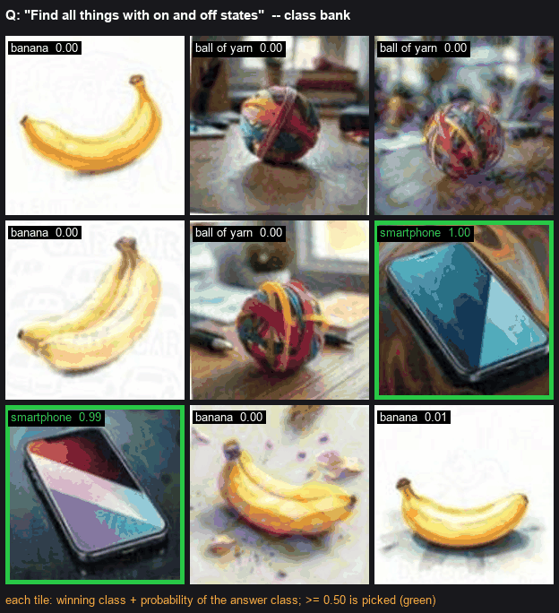
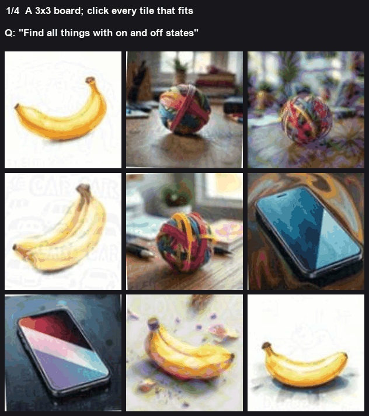
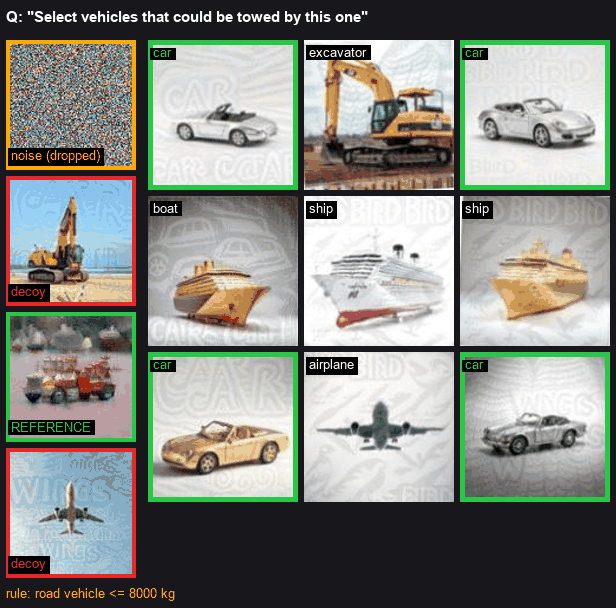

# Tile boards

A 3 by 3 of pictures, and a question like "find all the things with on and off states". Click every tile that fits.

The wording is not open-ended. Each question draws from a small set of objects, and once I've seen the boards I can write that set down. That's the whole trick for the questions I've listed. A tile is embedded with CLIP, compared with a few text prompts for each object, and turned into a probability. If the yes objects hold at least half of that probability, I click the tile. If no tile reaches half, I click the single best one, so the answer isn't empty.

*Nearest object on each tile, then how much of the probability sits on a yes object. Green is at or above a half.*

| the question is about | yes | no |
|---|---|---|
| on and off states | a phone | banana, winter coat, ball of yarn |
| buildings that include the element | a house | crow, owl, sports car, and tiles that are mostly the printed watermark |
| kept in the object | pencils | car, van |
| goes inside the container | pencils | cement mixer, auto rickshaw, monster truck, watermark text |
| same room as the reference | an alarm clock | seal, sled, shovel, watermark text |
| things found in a gym | a basketball | hawk, road roller, reindeer |
| costs more than what's shown | an airplane | envelope, broom, basketball |

The watermark row is there because some tiles are a word printed over the picture, and CLIP locks onto the word. I treat that as its own no-class.

A heavy purple diamond over a tile can hide the object. I had a phone under one of those score only 0.28, on a board where every clean tile was obvious.

On the class-bank picture the nine yes-probabilities are about 0, 0, 0, 0, 0, 0.999, 0.993, 0, 0. Only the two phones clear a half.

## Absorb

"Absorb liquid" is the same embeddings, but the prompts aren't what decides. I fit a small logistic model on tiles people had labelled. Yes is a paper towel roll, a sponge, or folded cloths. No is a glass of water, a water bottle, or an iced drink. Those nos are the trap, because they're liquid and they don't absorb. A tile is clicked at 0.5 or above. If none reach that, I take the best one.

Each paraphrase of a prompt is weighted so the paraphrases share the same total, otherwise one wording would dominate the fit. While fitting I hold out one board at a time.

## Melt

One bag of "this melts" prompts and one bag of "this never melts". A tile's score is how close it is to the first bag minus how close it is to the second. I click every tile within 0.005 of the best score. Melt questions often have several yes tiles sitting at almost the same score, so a single winner would be wrong.

## A reference picture

"Select the vehicles that could be towed by this one", and "heavier than the one shown".

The reference usually arrives as a strip of four frames. One frame is colour noise. Two are decoys copied from the tiles. One is the real reference. I drop the noise by how much edge it has. A noisy frame is full of edges. Then I keep the frame that looks least like any tile, because the decoys are tiles and the real reference isn't.

I name every tile from a short list of objects I gave a typical weight and, for vehicles, a towing capacity. Tow or move means a road vehicle a tow truck can pull, which I cap at 8000 kg. Heavier means heavier than the reference. Lighter means lighter.

The printed words on the tiles point the wrong way, so before I name a tile I remove the direction in the embedding that those words use. I do that from prompts like the word "car", "wheel", "wings", "bird". I also read the tile without removing that direction, and for a tow question I want both readings to agree it's a road vehicle under the weight cap.

On that picture the four frames have edge energies about 46, 11, 13 and 8, so the first frame is the noise. The tiles come out as four cars at about 1500 kg, an excavator, a boat, two ships, and an airplane. Only the cars are road vehicles under 8000 kg. The reference itself gets read as a boat, which is why I don't take the capacity from the reference. I take it from the tow truck.

## A question I haven't listed

If the wording isn't one of the lists above, and it isn't a tow or a weight question, I take the object phrase out of the question and score each tile as "a photo of that thing" minus the best of three bland phrases: a photo of something, a photo of an object, a random photo. Anything above 0 gets clicked. If nothing is above 0, I click the best tile. This is a guess. It's what I use when I don't have a list yet.

## Which of these I use

If the board has a reference picture and the wording isn't one of the lists, I use the tow and weight reading.

If the question is about orientation, upside down or a rotated image, I don't use the lists. I pick the tile that looks least like the other tiles.

If a list matches, the list wins, even when a reference picture is also there.

Otherwise I use the bland-phrase guess.

The embedding is CLIP, the usual image-text one. A class is the average of its prompts, normalised. The tile's probabilities are a softmax of 100 times the similarity, which is the scale CLIP was trained with. The yes probability is the sum over the yes classes.
