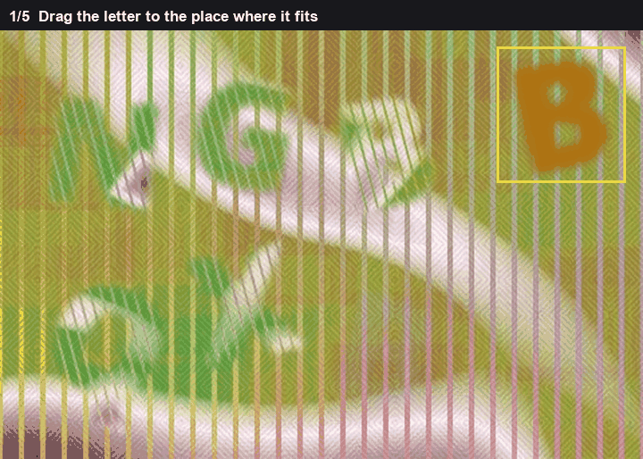
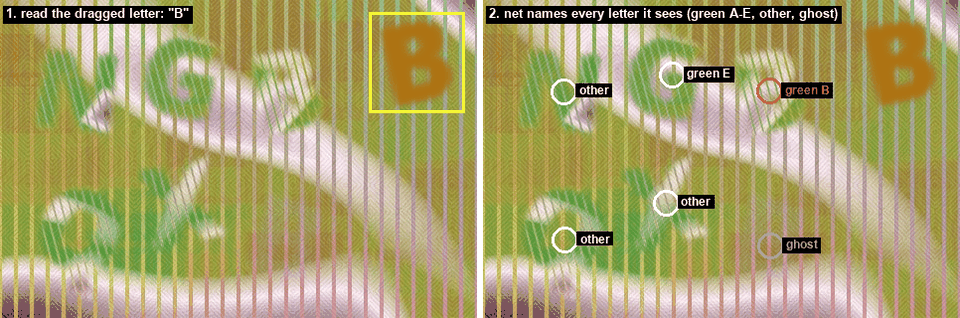
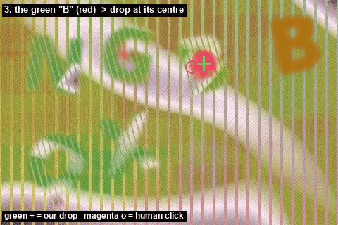
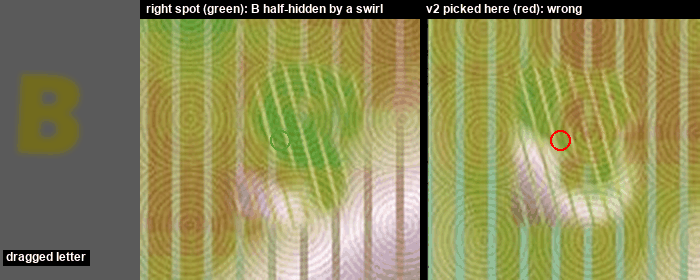

# Letter fits

Drag the letter to the place where it fits.

The piece in your hand is one letter, A to E. The board has several green striped letters and one pale ghost, which is there to look similar and be wrong. The place to drop is the green copy of the letter you're holding.

*Read the letter, then mark it on the board. Green is the drop.*

First I read the piece. I lay its shape over A, B, C, D and E, drawn in a set of bold fonts and tilted from 28 degrees one way to 28 the other. The overlap I use is soft: shared pixels over the pixels either shape covers. The best letter wins. I also keep how far it was ahead of the second best, because a close call is a bad read.

Then I look at the whole board. A small net labels every 4 pixel cell: background, green A, B, C, D or E, some other green letter, or the ghost. I take only the map for the letter I just read. The drop is not the single hottest cell. I keep every cell connected to the peak that is at least 60% of that peak, and I take the weighted middle of that blob. A second bright patch that doesn't contain the peak is ignored.

The net never saw a real board. I trained it on boards I generated. The weights I actually use were trained on boards where swirls cover a letter or bleach it out, with at least 30% of every letter left visible. That's the failure in the last picture: the right B is half under a white swirl, and a net that hadn't seen covers puts the point on a different spot.

The 60% cutoff was picked on generated boards I held out, not by staring at real clicks.

*The piece reads as B. Red is the green B on the board.*

*The map for B. Green cross is the drop. The ring is the click on this board.*

*The B that fits is half hidden. Without covered letters in the training, the point goes somewhere else.*

On the board in those pictures the piece reads as B, ahead of the next letter by 0.116. The map peaks at 0.997. About 72 cells sit around that peak above the cutoff, and another blob clears the cutoff but doesn't hold the peak, so I skip it. The middle of the blob is (289, 91). The click on this board was (272, 95).
