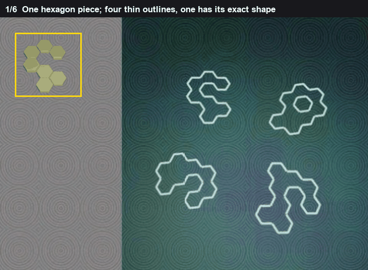
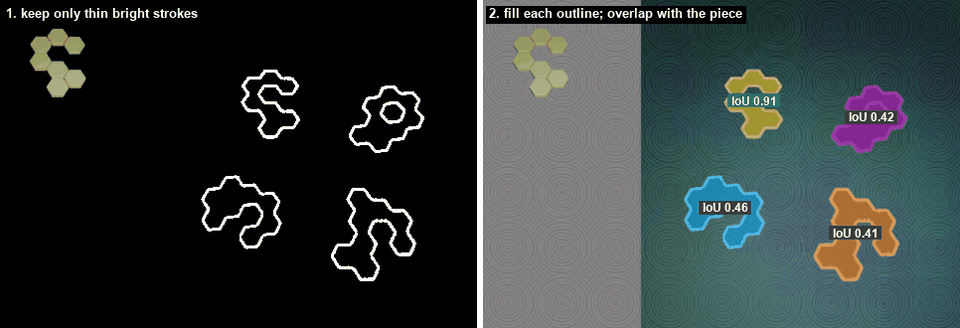
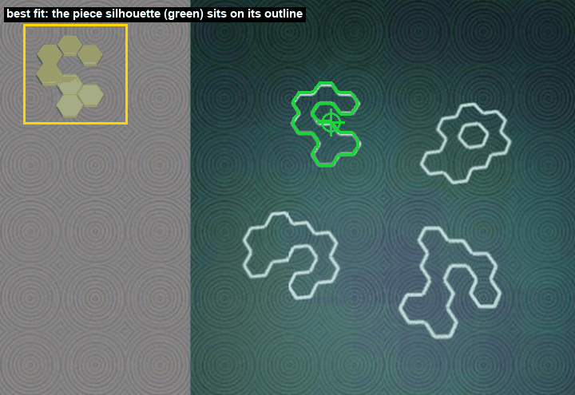

# Outline match

One filled piece, made of hexagons, sits on the left. Four thin outlines are on the right. One outline is the piece's silhouette. The others are different shapes.

The piece is filled. The outlines are strokes. They cannot be compared until both are the same kind of object: a solid mask. So the strokes are filled in, and then the two solids are overlapped.

*The strokes, then each outline filled, then the drop.*

## What counts as a stroke

The background is a texture, darker than the ink. A white top-hat on the brightest channel keeps thin bright lines and drops the slow texture. What remains above a fixed brightness is the stroke. On these boards the strokes sit above about 100 and the background under about 30, so the cut is not sitting on a boundary.

Each stroke is closed and then filled, including the holes. A C stays a C. If the holes were not filled as holes, a C and a disk would become the same blob.

A filled outline is kept only when its area is between about a third of the piece and three times the piece. A speck and a frame around the whole board both fail that. The piece itself is the filled opaque part of the piece image.

## The overlap

The piece mask is moved so its centre sits on the outline's centre. It is scaled by

`s = square root(outline area / piece area)`

so the two areas match. Area scales with the square of length, which is why the scale is a square root and not the ratio of the areas.

It is then turned from -6 degrees to +6 degrees, one degree at a time. The pieces are drawn upright. A search past a few degrees starts matching a shape to a rotation of a different shape.

At each angle the score is

`|piece ∩ outline| / |piece ∪ outline|`

Shared pixels, divided by pixels that belong to either shape. 1 would be the same mask. 0 would be no shared pixel.

*The C is 0.91. The next is 0.46.*

On the board in the pictures the piece covers 2144 pixels. Four outlines are candidates. Their best overlaps are 0.911, 0.458, 0.422 and 0.412.

Take the winner apart. Scale came out 1.053, so the outline is almost the same area as the piece. The best angle is +1 degree. The shared area is 0.911 of the union. The next shape shares less than half of the union. The margin is

`0.911 - 0.458 = 0.453`

Wrong shapes on this kind of board cluster near 0.4. The matching silhouette clusters near 0.9. There is no third cluster in between, which is why a single best-overlap is enough to pick the outline. The number 0.85 shows up only in the check below. It is not how the winner is chosen.

*The piece, in green, on its outline. The cross is the drop.*

## The drop, and the full-turn check

The piece's pixels are not always centred in the little image. On this board the image centre is (43, 41) and the mask centre is (39, 42). The shape sits about 4 pixels left of the image centre. The drop is the outline's centre plus that offset, so the shape lands on the outline, not the corner of the file.

The outline centre is (272, 103). The drop is (276, 102). The click on this board was (263, 104).

The same search is run again over a full circle, steps of 2 degrees. If some other outline wins once rotation is free, the upright match was an accident of the small angle range. If the best overlap anywhere in the full turn is under 0.85, the match is not in the 0.9 cluster. Either case marks the answer low. It does not change which outline was picked. On this board the full turn picks the same outline, at 0.904, which is still above 0.85.
