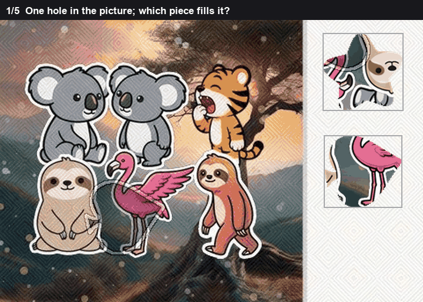
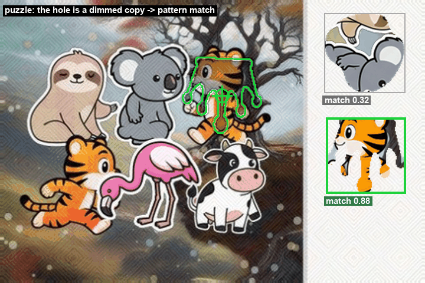
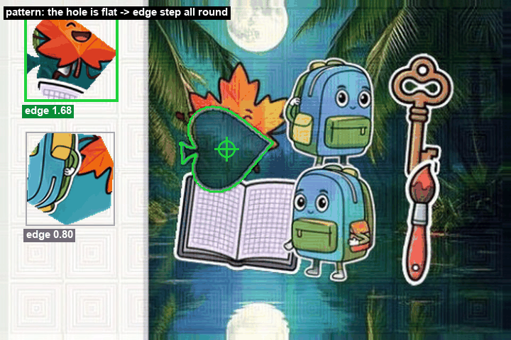

# Piece drag

Two pieces sit off to the side. The scene has one hole. The wording changes. The board does not.

The hole is one of two things, and the picture itself says which.

Sometimes the hole is the same picture as the right piece, painted darker, about half as bright. A darkened copy still correlates with the piece. A piece that was never in the scene does not.

Sometimes the hole is flat. A dark patch, or a grey animal silhouette. Nothing in the scene looks like the piece, so a picture match stays low, and the only thing left to measure is whether the piece's outline sits on the edge of that flat region.

The brightness test runs first. The outline test runs only when the brightness test refuses.

*One board. Green is where the piece goes.*

## Brightness match

The piece image has a transparent background. Only pixels that belong to the piece are compared, so the empty part of the little image cannot match the scene by accident.

The piece is slid across the scene. At each position the score is a normalised correlation of brightness. Same pattern of light and dark gives a score near 1. Unrelated patterns sit near 0, and can go a little negative.

On puzzle boards the matching piece lands between about 0.73 and 0.93. The other piece, which is not in the scene, stays at or below about 0.46. Those two clusters do not meet. The cutoff is placed in the empty gap, at 0.60. That is above every decoy in that band and below every real match.

A single score above 0.60 is not enough. Both pieces can be vaguely similar to some texture. The winner also has to lead the other piece by at least 0.20. A pair like 0.61 and 0.55 is inside the noise between them. A pair like 0.88 and 0.32 is not.

The third check is the dimming. At the best position, fit

`scene brightness = a × piece brightness + b`

A hole that was drawn at half brightness has `a` near 0.5. If `a` is 0.90 or more, the scene is a full-brightness copy of the piece, which means the template has landed on the piece itself rather than on a darkened hole. That match is thrown out.

*The tiger against the dimmed copy, 0.88 against 0.32.*

On that board the two scores are 0.882 and 0.324.

`0.882` is above `0.60`. The lead is `0.882 - 0.324 = 0.558`, which is above `0.20`. The fit gives `a = 0.544`, near one half and under `0.90`. All three tests pass, so the drop is the brightness match, not the outline.

The piece is 90 by 86 pixels and its top-left sits at (206, 65). The middle of the piece image is the drop:

`(206 + 90/2, 65 + 86/2) = (251, 108)`

The click on this picture was (254, 83), toward the top of the hole. The rule always uses the middle of the piece. It does not try to guess where a person aims inside the hole.

## Outline match

When the best brightness score is under 0.60, the hole is not a darkened copy. The piece is laid down as a mask. Around that mask, eight sectors. In each sector, the mean colour just outside the outline minus the mean colour just inside. The size of that jump is one number per sector.

The score keeps the weak end, the 25th percentile of the eight jumps, not the average. One strong edge and seven empty sides must not look like a fit. A real outline has a jump almost the whole way round, so even its weak sector is large.

That percentile is divided by how much the colour inside the piece already varies, plus 10 so a flat interior does not divide by zero. A noisy piece has jumps inside it. Without the division those interior jumps look like an outline.

This score is not a probability. It is a jump divided by a spread, so it can be larger than 1.

*The leaf outline on the flat hole, 1.68 against 0.80.*

On that board the brightness scores are 0.493 and 0.199. The best is under 0.60, so the brightness test stops. The outline scores are 1.677 and 0.799. The larger jump wins. There is no second cutoff here. The two pieces are ranked against each other.

The winning piece's middle lands at (213, 140.5). The click on this picture was (217, 136).
