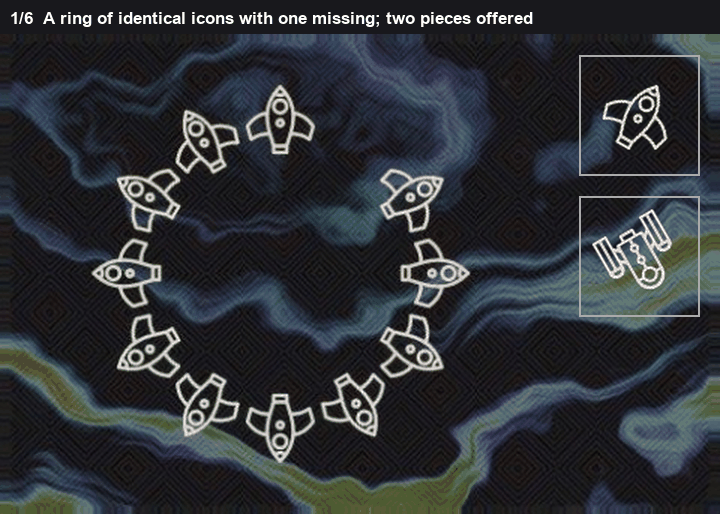
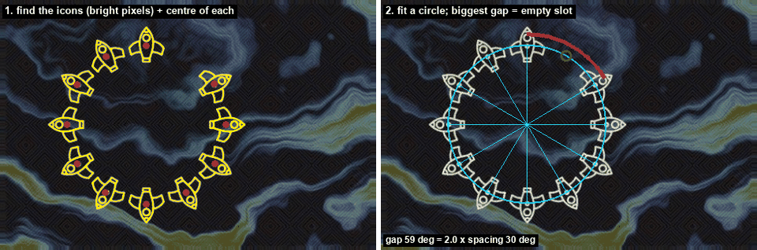
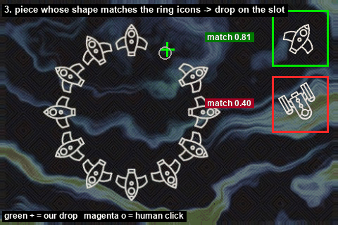

# Ring complete

The same icon is repeated around a circle, with one position empty. Two pieces are offered. One is that icon. The other is a different icon.

If the icons were evenly spaced and one is missing, the empty step is the sum of two ordinary steps. The ratio of the large gap to a normal gap is about 2. That is the whole rule. Everything else is getting centres onto a circle so the angle gap can be measured.

*The icons, the circle, the wide gap, the drop.*

## Icons, then a circle

The background on these boards is dim, about 70 to 100 in each channel. The icons are about 180 to 200. A pixel is kept when the darkest channel is at least 150. That cut sits between the two ranges, so it is not tuned to one board.

A few pixels of thickening join the strokes of one icon into one blob. A blob is kept when its long side is between 25 and 80 pixels and it has at least 100 stroke pixels. Specks and the big circle behind the icons fail that.

A circle is fit by least squares through the centres. If one centre is more than 15% of the radius off the circle, that icon is dropped and the circle is fit again. 15% is a missed detection, not the wobble of a real icon. The fit needs at least five centres. Fewer than that and a circle is not determined.

Image y grows downward, so 270 degrees is straight up. The angle of an icon is `atan2(y - cy, x - cx)` with that axis.

## The gap ratio

Sort the angles. Each gap is the step to the next angle, wrapping around 360 degrees. The typical step `s` is the median of the gaps that are not the largest one. The ratio is the largest gap divided by `s`.

One missing icon makes a gap of about `2s`. Drawing error and a slightly oval fit move that off 2, but not down to 1 and not up to 3. The accepted window is 1.5 to 2.6. Below 1.5 the largest gap is just the ordinary unevenness of the ring. Above 2.6 two icons are missing, or the circle fit joined the wrong blobs. There also has to be exactly one gap at least `1.5s`. Two wide gaps means the empty spot is ambiguous, and the rule returns nothing.

*Icons and their centres, then the one wide gap.*

On the board in the pictures there are 11 icons. The circle is near (186, 159) with radius 101. The worst centre is 0.005 of the radius off the circle, far inside the 15% cut.

The ordinary gaps are 29.3 to 30.5 degrees. One gap, from 270.0 to 329.5, is 59.4 degrees.

`s = 30.1`

`59.4 / 30.1 = 1.97`

1.97 is inside 1.5 to 2.6, and it is the only wide gap. The slot is the middle of that gap, angle 299.7 degrees:

`(186.5 + 101.4 cos 299.7°, 159.3 + 101.4 sin 299.7°) = (237, 71)`

## Which piece

Each offered piece is compared with the icons on the ring. For each ring icon the piece is turned through 72 angles, 5 degrees apart, and the best overlap is kept. Overlap is shared pixels over pixels in either shape, after both masks are centred. The piece's score is the median of those best overlaps, so one lucky icon cannot carry it.

The same cluster split as the outline task shows up here. The right icon lands near 0.8. The wrong icon lands near 0.4. The rule asks for a best score of at least 0.60, which is in the gap, and a lead of at least 0.15, so two middling scores cannot pick a winner.

*The rocket is 0.81. The other piece is 0.40.*

On this board the rocket is 0.813 and the other piece is 0.398.

`0.813 - 0.398 = 0.415`

0.813 is above 0.60 and the lead is above 0.15, so the rocket is the piece.

The drop shifts the slot by the difference between the piece image centre and the piece mask centre. Here that shift is about half a pixel in x and about a pixel in y, so the drop is (237, 70). The click on this board was (234, 75).

A second number is computed and not used. The two icons beside the gap are turned to face the gap, and each piece is compared with that pair as it was served, without searching rotation. On this board that number is 0.816 against 0.377, the same winner. It is stored. It does not choose.
