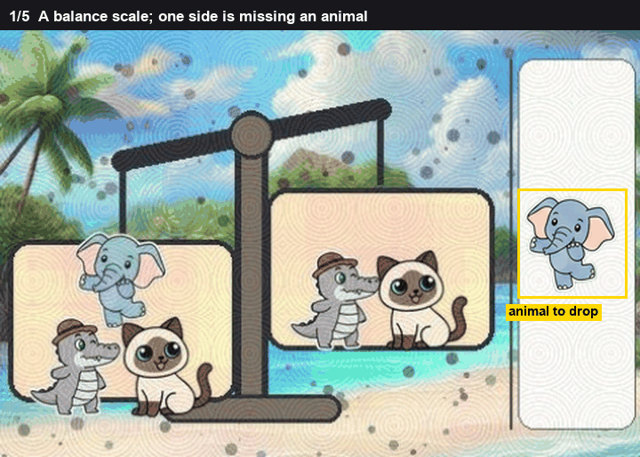
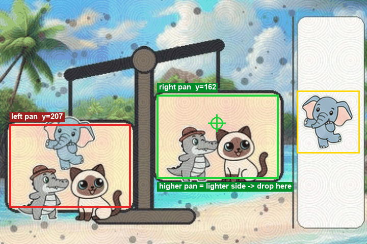
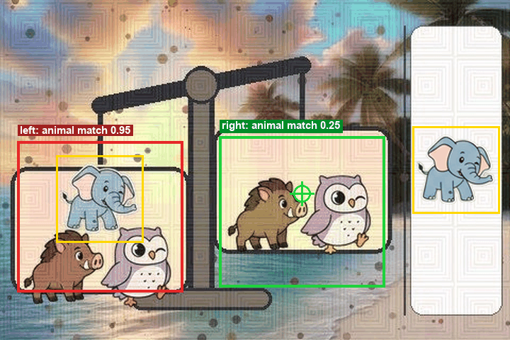

# Scale

The animal goes on the side that is still light.

A scale beam is a picture of a lever. The heavier pan hangs lower. If one pan is visibly higher, that side is the one missing weight, and the animal goes there. The animal's identity does not matter until the beam is level, because a level beam is not telling you which side is light.

*The two pans, then the side the animal goes to.*

## Finding the two pans

A pan is a light rounded interior closed by a dark stroke. The stroke is the dark pixels, grown a little so a broken line still closes. The interior has to be bright and not very colourful, otherwise an animal already sitting in the pan gets counted as the pan.

The region must not touch the border of the picture. It has to be at least a couple of thousand pixels, wider than about 40 and not a huge blob, and it has to sit in the lower part of the board, left of the piece strip. Those limits are the size and the place pans actually occupy on these boards. A dark curve in the corner fails them.

If the animal already in a pan splits the interior into pieces, the pieces are merged back into one pan. The pair that is kept is the one where both pans are large and their heights are not far apart just because the grouping was bad. A pair with one pan twice the area of the other is a bad grouping, not a tilted scale.

The centre of a pan is the average of its pixels, not the centre of its box.

## When height decides

`dy` is the right centre's y minus the left centre's y. Image y grows downward, so a negative `dy` means the right pan is higher on the screen.

The height rule is used only when both pans were found as regions, and `|dy|` is at least 15 pixels.

15 is the gap between two kinds of difference. A rough outline moves a centre by a few pixels even when the beam is level. A tilt that is drawn on purpose moves a pan by tens of pixels. 15 sits between those. Under 15, height is treated as noise and the rule moves on to the animal picture.

*The right pan hangs higher.*

On that board the centres are about (92, 207) and (284, 162).

`dy = 162 - 207 = -45`

`|dy| = 45`, which is past 15, and both pans were real regions. The higher one is the right pan. The drop is its centre, (284, 162). The animal picture is not consulted. The click on this picture was (283, 149).

## When the picture decides

If `|dy|` is under 15, or the pans had to be guessed, height is not evidence.

The animal sprite is slid over each pan. Transparent pixels are ignored. The score is the same normalised brightness correlation as a darkened-copy match. The sprite is tried at scales 0.62, 0.72, 0.82, 0.92, 1.0 and 1.1, because the drawn animal is not a fixed size. Each pan keeps its best scale.

The empty pan is the one with the lower score. The animal is already sitting in the pan that matches.

The two scores have to differ by at least 0.05. Two pans can both pick up a little correlation from a loose template. A gap under 0.05 is that leftover, not a missing animal.

*The elephant is already in the left pan.*

On that board the outlines never closed into a clean pair, so the centres are the usual ones, near x = 94 and x = 284, read off the dark rim. Height is not used. The elephant matches the left at 0.947 and the right at 0.248.

`0.947 - 0.248 = 0.699`

0.699 is well past 0.05, so the right pan is the empty one. The drop is that pan's centre.

## The last comparison

If the brightness gap is under 0.05, each whole pan is embedded with the animal and the two cosines are compared. Cosines of whole pictures sit much closer together than a masked correlation, so the gap required there is 0.015, not 0.05. The pan with the smaller cosine is the one that looks less like the animal.

If that gap is also under 0.015, nothing in the pictures separates the pans. The rule goes back to whichever centre is higher, even if the difference is small.

When the outline finder fails, the fallback looks for the dark rim near the usual pan columns. The lower rim is the lower pan. The centres are built from those rims rather than from a filled region. A height read off a guessed rim does not get to use the 15 pixel rule. Only a real pair does.
