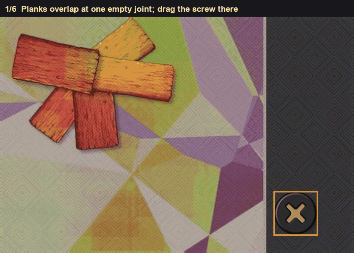
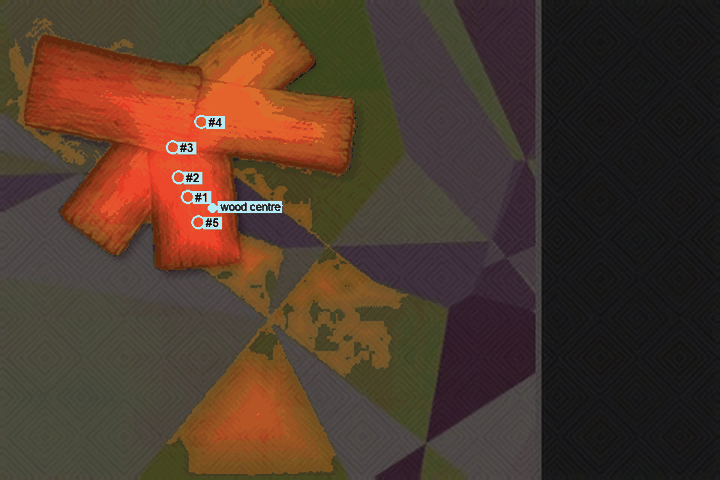
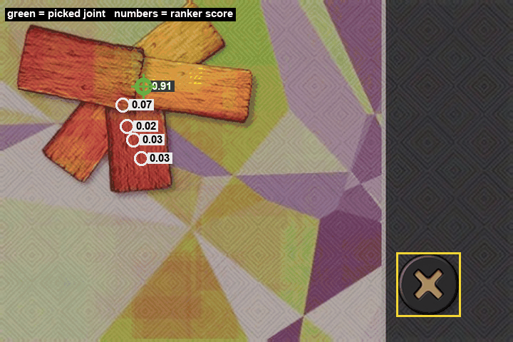

# Screw

Drag the screw to the empty joint.

The joint is where the planks overlap. It's thicker than the middle of a single board, and it sits in toward the middle of the cluster, and the plank edges arrive there from more than one direction.

*The wood, the thick spots, then the one I keep.*

I mark the wood by colour. Hue toward red or orange, fairly saturated, not black. I cut off the right-hand strip, because that's where the screw piece sits, not the planks. I keep the biggest connected piece of wood. That's the cluster.

For every wood pixel I measure how deep it is inside the wood, and how close it is to the middle of the cluster. The score is those two multiplied. Deep and central is a candidate. I take the best peak, snap it to the middle of the high-scoring pixels around it, blank out a small square so I don't pick the same joint twice, and repeat. Up to 8 spots.

Those spots are not all joints. A thick place in the middle of one plank scores well and is wrong. So I re-rank the top 5 with a small model I fit on 86 labelled boards. The feature that matters most is how mixed the edge directions are in a small window. I take the edges that are actually strong, bin their directions into 8 bins, and measure the entropy. A real joint has plank corners coming in at different angles, so the entropy is high. A point in the middle of a plank has edges that mostly share a direction. That feature carries about 0.40 of the model's weight. Brightness carries about 0.13, and so does the geometric score relative to the best peak, and the amount of edge nearby. The drop is the candidate with the highest chance of being a joint.

*Red is depth times how central the pixel is. The numbers are the geometric candidates, before the re-rank.*

*After the re-rank, candidate 4 is the one. That's where the plank edges cross.*

On the board in the pictures the wood is about 35 thousand pixels, centred near (142, 139). The geometric winner is at (125, 131). It's deep, it's close to the centre, and the model gives it almost nothing, about 0.035. Candidate 4 is at (134, 81). Its geometric score is worse, but the edge directions there are the most mixed of the five, and it's brighter than the others (about 127 against about 96). The model puts it at 0.907. Drop there. The click on this board was (129, 69).
