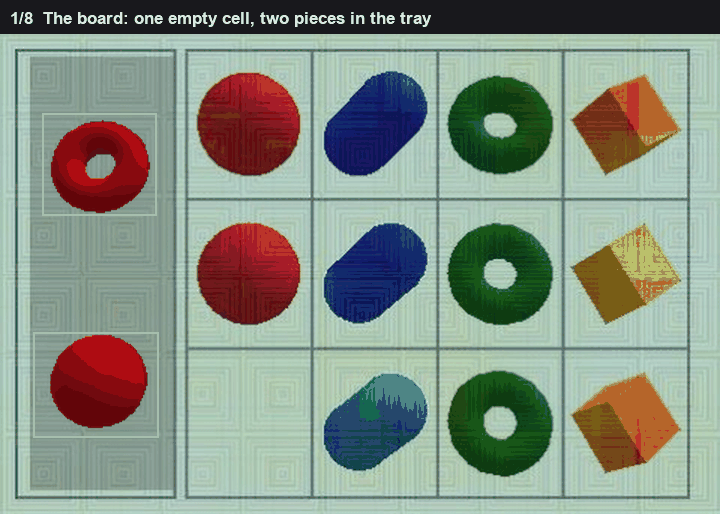
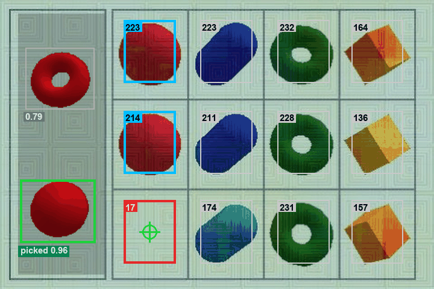

# Shape grid

Bright shapes sit on a lattice. One cell is empty. Each column is one kind of shape, so the piece that belongs in the hole is the one that matches the other shapes in that column.

The lattice is not drawn as lines. It has to be read off the centres of the shapes that are there. The empty cell is not drawn as a marker. It is the cell whose middle still looks like the background.

*The lattice, the empty cell, the piece.*

## The lattice

A shape pixel is one whose channels differ by more than 55, so it is actually coloured, and whose brightness is under 235, so it is not the white page. The pixels are grown by 2 so a thin shape stays one blob. A blob is kept between 1500 and 20000 pixels, and only if it is outside the draggable pieces. The centre of a blob is the average of its pixels.

Centres are clustered per axis. Any two within 40 pixels are the same row or the same column. 40 is less than the gap between columns and more than the jitter of a centre, so two shapes in one column collapse and two columns do not.

The pitch is the lower-quartile gap between the merged centres, not the mean. One missing shape makes one double gap. The mean would swallow that and stretch every column. The lower quartile stays on the ordinary step. A gap of `k` pitches is filled with `k - 1` missing lines. That is how the empty cell gets a coordinate even though no shape is standing there.

## Which cell is empty

The background colour is the median pixel of the whole board. For each lattice cell, take the box in the middle, plus or minus 0.35 of the pitch, and the median distance of those pixels from the background. A cell with a shape in it is far from the background. The empty cell is close to it.

The empty cell has to be at or under 0.65 times the median cell. 0.65 is below the filled cells and above the empty one. A slightly dim shape still scores well above two thirds of the median. An empty cell scores a small fraction of it.

*The number in each cell is its distance from the background. The empty one is 17. The rest are 136 to 232.*

On that board the columns are at x = 166, 250, 336, 417. The gaps are about 82 pixels, so the pitch is 82, and no column is missing. The rows are at y = 57, 157, 257, pitch about 99.

Background is about (165, 191, 171). Column 1, row 3 has fill 17.4. The other cells run from 136 to 232. The median is 212.6.

`0.65 × 212.6 = 138.2`

17.4 is under 138.2. Every filled cell is over it. The empty cell is that one. The drop is the lattice point itself, (166, 257), not a search inside the cell. The click on this board was (165, 252).

## Which piece

Each piece, and each other shape in the empty column, becomes a 64 by 64 silhouette. The column shapes are the dark part of a crop around the cell, the crop being plus or minus 0.55 of the pitch, and only the part that touches the cell centre. That stops a neighbouring shape from entering the silhouette.

Overlap is shared pixels over the union. A hole fraction is `1 - area / filled area`. A ring has a hole fraction near 1. A disk has 0.

`score = mean overlap with the column shapes - |hole of the piece - median hole of the column|`

The subtraction is there because a ring and a disk can share a lot of area and still be different objects. If the column is solid, a piece with a hole pays the hole fraction as a penalty.

On this board the column shapes are solid, hole fraction 0. One piece overlaps them at 0.874 but has hole fraction 0.081, so

`0.874 - |0.081 - 0| = 0.793`

The sphere overlaps at 0.958 and has hole fraction 0, so the score stays 0.958. The sphere is the piece. There is no extra cutoff. The scores are compared with each other.
