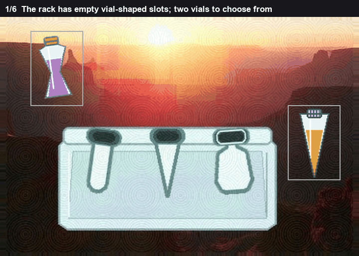
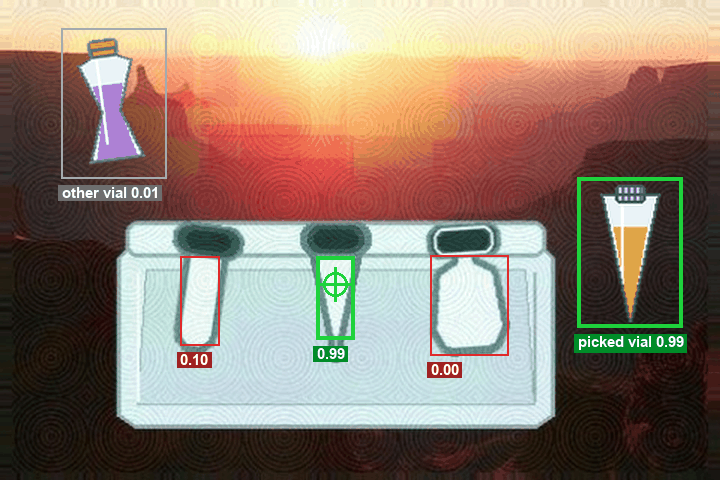
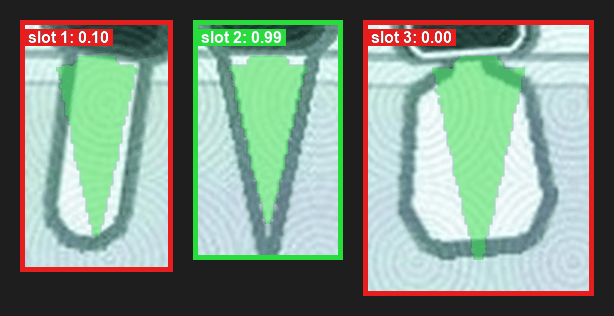

# Vial

Move the right vial into the empty slot that matches its shape.

The rack has a few dark vial-shaped holes. The pieces are vials on a transparent background. One pair fits.

*The slots, the silhouettes, the pair that fits.*

I find the holes two ways, because sometimes the outline is what I can see and sometimes the bright inside is.

The outline way: dark, tall, narrow-ish components, mostly dark pixels, not down in the bottom strip of the board. If two finds have centres within about 25 pixels I call them the same slot. I try more than one darkness cutoff, because the outline isn't the same grey on every board.

The inside way: a bright region, taller than it is wide, with a dark cap just above it. If that lands on a slot I already have from the outline, I skip it. The inside of the slot is the bright part. If the bright part only floods some of the hole, I fill each row from the left edge of the outline to the right edge.

Then every vial against every slot. I scale the vial to the slot's height and I write down a handful of numbers.

How well the edges line up, as a distance from each outline to the other. Closer is better, so I negate it, and I try a few sizes and a few small shifts.

Whether the width from top to bottom rises and falls the same way. That's a correlation of the row widths.

How much the interiors overlap, again over a few sizes and shifts.

A single comparison of the proportions: aspect ratio, plus the width profile.

How full the slot's inside is, and how that compares with the other slots in the rack. A slot that didn't fill properly shouldn't look like a match just because the numbers got small.

Two of the numbers are just flags for "I couldn't compute the profile" or "I couldn't compute the overlap", so a broken measurement doesn't look like a zero.

A small model I fit on labelled vial-and-slot pairs turns those numbers into one score. The edge distance carries most of it, about 0.61. The aspect and the interior overlap carry about 0.13 each. The best pair wins.

I don't drop on the centre of the slot's box. The box includes the outline and some margin. I drop on the middle of the inside area.

*The cone on the cone slot is about 0.99. The other vial, on its best slot, is about 0.01.*

*The cone silhouette scaled into each slot. Only one of them follows it.*

On the board in the pictures there are 3 slots. The cone on the matching slot has an edge distance near zero (the negated score is -0.46), the width profiles correlate at 0.88, the interiors overlap at 0.85, and the aspect gap is 0. The model puts that pair at 0.992. The same vial on the next slot falls to 0.097, with the edges far apart and the profiles only correlating at 0.41. The other vial is under 0.02 everywhere. The slot's box is centred near (224, 198). The inside of the slot is higher than that, near (224, 190), and that's the drop. The click on this board was (223, 195).
