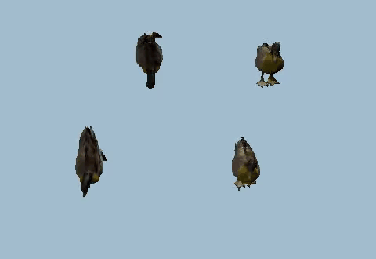
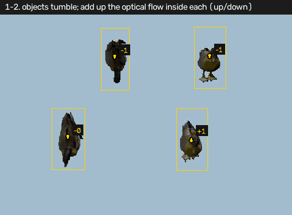
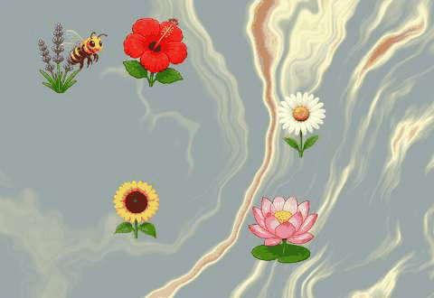
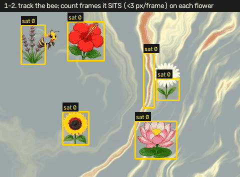
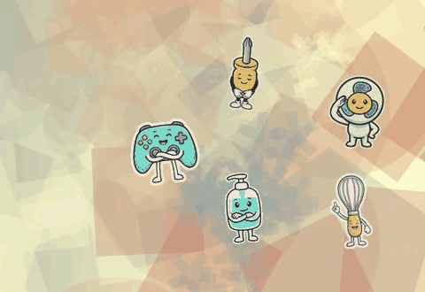
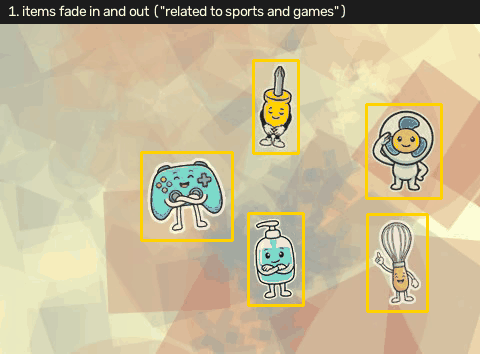
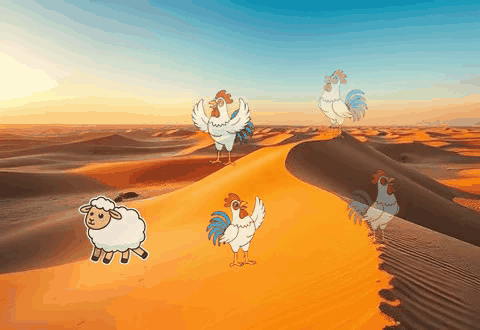
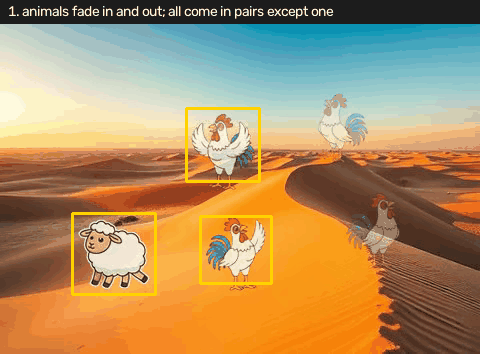
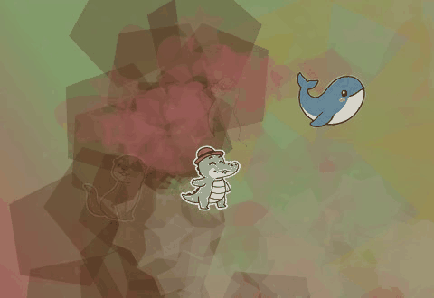
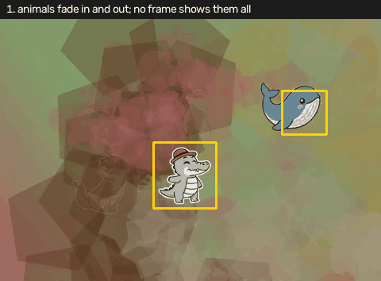

# Video

Click a spot in a short clip. A page is a few seconds, 480 by 330. The point is in the video's own pixels. Whatever shows the clip on the page has to scale that point up to the size it draws the video at.

The still-picture versions of turning, the bee, and odd one out are in the area note. I have real clips for these. I mostly don't have real stills.

The words pick the reading. Turning. A bee that never lands, or does not land. Something "related to" a category. Unpaired, different, or the odd one. An animal that lays eggs.

When the strict rule doesn't find exactly one answer, I still give my best guess and I mark it as a low-confidence guess. I'd rather return a point than return nothing, and the mark says I know it's the weak one.

## Turning

Find the object turning against the group.

Each object is the pixels that differ from the flat background at any time in the clip. The background is the median colour over time. I measure the motion inside each object, up and down and left and right, skipping the stretches where everything is basically still. Whichever direction has the larger motion, across the objects, is the one I read. All of them move the same way except one. I click that one.

I refuse the reading if the two directions are close. If up-and-down isn't at least twice left-and-right, or the other way around, I don't know which axis the clip is using. I also need the odd object to be the only one with its sign, and I need at least two objects on the normal side. If that fails, the fallback is the object with the least motion in the normal direction, and it gets marked low.

*Four objects, tumbling.*

*Each object's up and down motion, added up over the clip. Three finish near +34 to +41. One finishes at -35.*

On that clip the vertical sums are about -35, +34, +34, +41. The horizontal sums are only a few pixels, so vertical is the axis, by a wide margin. The negative one is the odd object. Its middle is (345, 70). The click on this clip was (344, 70).

## The bee

Click the flower the bee never lands on.

The flowers stay put and the bee moves, so the median of every frame is the scene with the bee erased. I find the flowers in that still scene, as strong edges, filled in. I track the bee as the blob that differs from the median. A landing is a frame where the bee barely moves, under about 3 pixels, looking at the frame before and the frame after. I count those frames inside each flower.

The flower with a count of zero is the answer. It also has to look like a flower: not a thin streak, and not tiny next to the flowers the bee did visit. If two things have a count of zero, I keep the one that passes that test. If I still don't have exactly one, I try the largest thing the bee never touched, then I search again with a weaker edge threshold, then I take whichever flower was visited least. Those are the low-confidence guesses.

*The bee lands on some flowers and skips one.*

*The path in blue. The dot goes red while the bee is sitting. The number on each flower is how many frames it sat there. The sunflower is the flower with 0. The grey streak also has 0, and it isn't a flower.*

On that clip six sprites have sit-counts of 4, 4, 0, 4, 0 and 2. Two zeros. The one near (296, 134) is the grey streak, too wide for its height. The flower is near (151, 230). The click on this clip was (151, 235).

## Related to a category

Select the item related to sports and games. The category comes from the question. Sports is the one I've worked through.

The items stand still, but they fade in and out, so no frame shows all of them. Where the picture changes over time is where an item is. If two items overlap in space, I split them by when they fade. Pixels whose brightness rises and falls together are one item. I take each item at the frame where it's sharpest, embed it, and score it against the category minus a bland "this is a cartoon object" prompt. The highest score is the click.

If the gap down to the second item is under about 0.008, I don't trust it much. The scores live in a small range. A tiny lead is noise.

If the winning box is a lot bigger than a typical item, two items got merged. I split the box along its long side, score both halves, and click the better half.

*Six items, fading in and out.*

*Each item at its sharpest frame, with its score. The game controller is the high one.*

On that clip the six scores are about 0, -0.011, -0.001, +0.021, -0.008, -0.003. The controller leads by about 0.022, which is enough. Its middle is (185, 169). The click on this clip was (181, 172).

## Odd one out

The unpaired animal, or the icon that is different.

I find the items the same way as the category clip. For an icon question the items come from the change in the picture itself, and I crop that change map rather than a colour frame. Each item gets an embedding. I look at its closest match among the others. A pair, or a repeated icon, has a near twin. The one whose closest match is the weakest is the odd one.

I'm confident when the gap between the weakest match and the next-weakest is at least 0.04. Closer than that and two items are both a bit lonely, and I might have the wrong one.

*Five roosters and one sheep.*

*Each animal, then its closest match among the others. The sheep's match is the weak one, 0.827.*

On that clip the closest-match scores are about 0.949, 0.949, 0.948, 0.948, 0.827, 0.892. The sheep is 0.827. The next loneliest is 0.892, a gap of 0.065. The sheep's middle is (114, 228). The click on this clip was (116, 231).

## Lays eggs

Choose the animal that lays eggs.

Same way of finding the items, same sharpest frame. I name each one against the six animals these boards actually use: manatee, capybara, otter, whale, sea lion, and a crocodile in a hat. The crocodile is the only one of those that lays eggs, so I click whichever item comes out as the crocodile.

A board has two pages. Two clips. I answer each page on its own.

If the top name is the crocodile, I'm confident. If no item is named crocodile, I click the one with the highest crocodile probability and I mark it low. A box that's much bigger than the other items gets split the same way as in the category reading.

*One page. They fade in and out. No frame has all of them.*

*Each animal at its sharpest frame, with the name and the egg probability. The crocodile is about 0.93.*

On the first page of the board in the pictures the five items come out as sea lion, sea lion, whale, crocodile, otter. The crocodile probability on those is about 0.05, 0.02, 0.03, 0.93, 0.01. Only one egg-layer. Its middle is (233, 199). The click on this page was (234, 203).

The other page is the same situation. Crocodile near 0.91, everything else at about 0.10 or under. The click is (242, 115).
