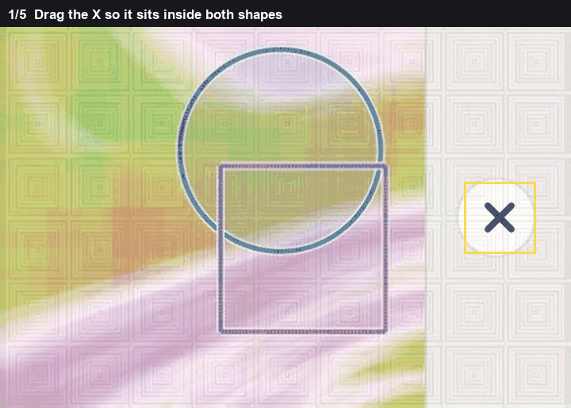
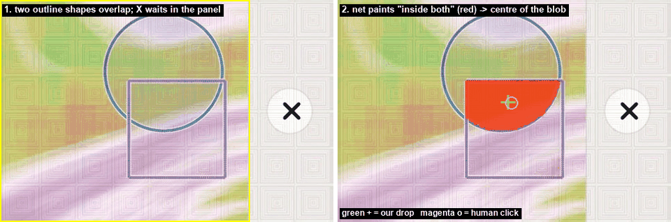
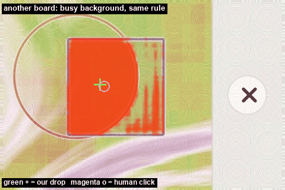

# Both shapes

Two outlines overlap on a noisy background. The X has to land in the overlap. The X itself waits in the right-hand strip, so that strip is not part of the picture being searched. The search is the left 75% of the board.

The overlap is not a colour. Both shapes are strokes, the background is a swirl, and the overlap is a region with no mark of its own. A geometric fit can draw a circle and a rectangle and intersect them. That fails when the stroke is broken or the shape is neither. A net can be taught the overlap directly, because on a drawn board the overlap is known pixel by pixel.

*The overlap, then the drop.*

## What the net is shown

A training board is two random shapes on a swirl. The drawing knows which pixels fall inside both shapes. The net sees the left part of the board, reduced to half resolution, and for every 4 pixel cell it must say "inside both" or "not". Training pushes those two probabilities toward the drawing.

The drop is not the hottest cell. The hottest cell is often on the boundary of the overlap. The blob is every cell connected to the peak whose probability is at least 0.70 times the peak. The drop is the probability-weighted centre of that blob, which is the middle of the region.

## Where 0.70 comes from

The same decode was run on drawn boards that were not in the training, at cutoffs 0.30, 0.40, 0.50, 0.60, 0.70 and 0.80. A cutoff hits when the weighted centre falls within 25 pixels of the true centre of the overlap. 0.70 is the cutoff that hit most often. Lower pulls the centre toward paint that spilled outside the shapes. Higher collapses the blob onto the peak, which is not the centre.

*A circle and a square. Red is the overlap the net painted.*

On that board the peak is 1.000 in the cell at board pixel (210, 158). The cutoff is `0.70 × 1 = 0.70`. 508 cells are at or above 0.70, all in one blob. The weighted centre is (245.3, 147.8). That is not the peak cell. It is the middle of the 508. The click on this board was (250, 148).

*Paint spills past the circle. The centre of the blob is still inside both shapes, because the spill is a thin rim and the mass of the probability is in the overlap.*

If the weights are missing, or no cell forms a blob, the fallback fits a circle or a rectangle to each coloured stroke and drops at the centre of the intersection of those two fits. That path does not use the 0.70 cutoff. It uses the geometry of the strokes.
